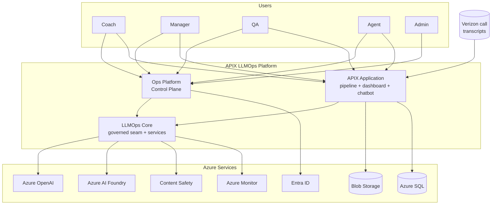
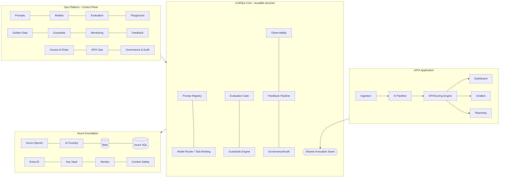
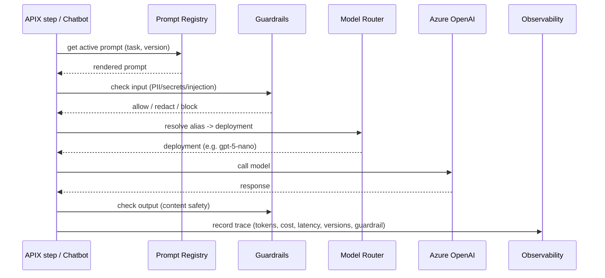
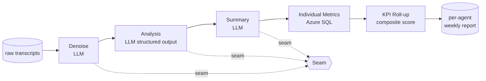
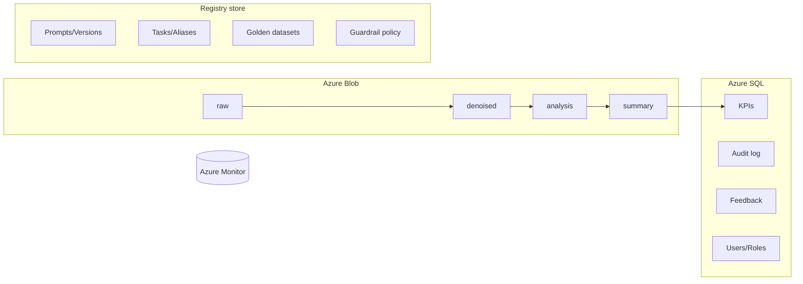
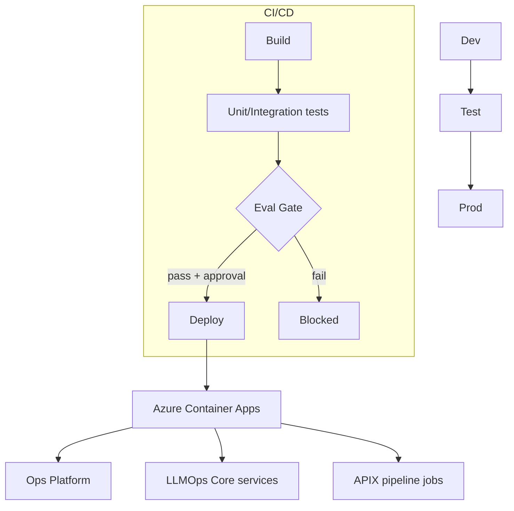
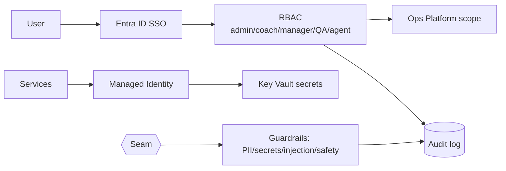
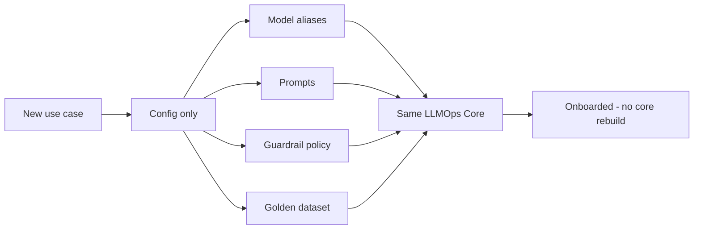

# Solution & Technical Architecture
## APIX LLMOps Platform

> Visual-first. Diagrams render in GitHub / VS Code / most Markdown viewers. Text is intentionally concise; the diagrams carry the design. Traces to BRD (01) and SRS (02).

---

## 1. Introduction
**Purpose:** define the Azure-native, buildable design for the APIX LLMOps Platform — the Ops Platform (control plane), the reusable LLMOps core, and the APIX application.
**Principles:** config-driven (not code) · Azure-native · single invocation seam · fail-open · build-once-reuse · governed by default.

---

## 2. System Context

---

## 3. Logical / Layered Architecture

Every APIX module and every Ops action reaches a model only through **L2's seam**. The Ops Platform operates L2; the APIX app consumes it.

---

## 4. The Shared Invocation Seam  (the one path every LLM call takes)

This seam is what makes governance uniform and the platform reusable: a new use case plugs into the same path.

---

## 5. APIX Pipeline Architecture

Daily: denoise, analysis. Weekly: summary, metrics, KPI. Only analysis makes AI judgments; downstream is arithmetic (testable, auditable).

---

## 6. Data Architecture

Registry store (prompts, tasks, golden data, policy) — technology decision tracked as **ADR-1** (Cosmos vs reuse Azure SQL).

---

## 7. Deployment Architecture

Each environment resolves its own aliases, thresholds, and guardrail policy by config. The evaluation gate is a required, blocking CI/CD step.

---

## 8. Security & Identity Architecture

No PII in telemetry. Least-privilege managed identities. Every privileged action audited.

---

## 9. Reusability Design

Onboarding a second use case = new config + golden data, not new platform code (BR-16).

---

## 10. Technology Stack

| Layer | Technology |
|-------|-----------|
| Ops Platform frontend | React + TypeScript |
| Backend / core services | Python, FastAPI |
| AI models | Azure OpenAI (gpt-5-nano family) |
| Prompt/eval tooling | Azure AI Foundry (prompt flow, evaluation) |
| Structured data | Azure SQL |
| Unstructured/raw | Azure Blob Storage |
| Registry store | Cosmos DB or Azure SQL (ADR-1) |
| Identity / secrets | Entra ID (SSO), Key Vault |
| Observability | Azure Monitor / App Insights |
| Content safety | Azure AI Content Safety + custom rules |
| CI/CD / hosting | GitHub Actions or Azure DevOps · Docker · Azure Container Apps |
| Notifications | Azure Communication Services / Teams |

---

## 11. Infrastructure Cost Estimate

> Order-of-magnitude, consumption-based (PAYG) estimates at **production scale (~100,000 calls/day ≈ 3M/month)**. Anchored on the APIX POC costing (gpt-5-nano). Final numbers depend on confirmed scale (open item D-2), region, and retention. Dev/Test add roughly +20–30% of the non-AI baseline (AI spend is minimal in lower environments).

### 11.1 Monthly estimate — Production

| Service | Purpose | Pricing model | Est. / month |
|---------|---------|---------------|-------------|
| Azure OpenAI (gpt-5-nano) | All LLM inference (denoise/analysis/summary + chatbot) | Per token | ~$1,725 |
| Azure Container Apps | Ops Platform + Core services (always-on) + pipeline jobs (scale-to-zero) | Consumption | ~$300 |
| Azure SQL Database | KPIs, audit, feedback, users | Serverless / GP | ~$300 |
| Azure Monitor / App Insights | Telemetry (metadata only) | Per GB ingested | ~$200 |
| Azure AI Foundry | Prompt flow + evaluation runs | Token + compute | ~$150 |
| Azure Blob Storage | Transcripts + parquet outputs | Per GB + ops | ~$100 |
| Cosmos DB (if registry store) | Prompts/tasks/golden/policy (ADR-1) | Serverless | ~$25 |
| Azure Communication Services | Email / Teams notifications | Per message | ~$20 |
| Key Vault + Container Registry | Secrets + images | PAYG | ~$10 |
| Entra ID | SSO | Existing M365 | $0 incremental |
| Azure AI Search | RAG (future use cases) | — | $0 (not Phase 1) |
| **Subtotal (layered guardrails)** | | | **~$2,830 / month** |
| Azure AI Content Safety | Cloud moderation — **see cost lever below** | Per 1k records | ~$200 selective → ~$2,300–6,000 if 100% |

### 11.2 Key cost levers (architecture decisions with real money attached)
- **Content Safety is the swing factor.** Moderating 100% of calls (input + output ≈ 6M records/month) could cost **$2,300–6,000/month** alone — more than the LLM itself. The layered guardrail design (Foundry filters as the floor + custom regex for PII at ~$0, Content Safety only on flagged/high-risk traffic) keeps this to ~$200. This is why the guardrail architecture matters financially, not just for safety.
- **Scale-to-zero pipeline jobs** (Container Apps Jobs) cost nothing between runs.
- **Serverless SQL + Cosmos** auto-pause/consumption-bill instead of reserved capacity.
- **gpt-5-nano** is ~55% cheaper than GPT-4o-mini and ~80% cheaper than GPT-5-mini for this workload.

### 11.3 Phased cost (scales with volume)
| Phase | Calls/day | Est. all-in / month |
|-------|-----------|---------------------|
| Phase 1 — pilot | 100 | ~$700 (platform baseline dominates; AI tiny) |
| Phase 2 | 1,000 | ~$900 |
| Phase 3 | 10,000 | ~$1,500 |
| Phase 4 — full | 100,000 | ~$2,830 (layered guardrails) |

At low volume the **always-on platform baseline** (Ops Platform, SQL, Monitor) dominates; at full volume the **LLM inference** dominates. Dev + Test together add ~$400–600/month.

### 11.4 Caveat
These are planning estimates for sizing and budgeting. A detailed Azure Pricing Calculator model should follow once scale (D-2), region, and retention (compliance) are confirmed.

---

## 12. Architecture Decision Records (ADRs)
- **ADR-1 — Registry store:** Cosmos DB vs reuse Azure SQL for prompts/tasks/golden/policy. *(Open)*
- **ADR-2 — Orchestration:** native pipeline orchestration vs Foundry/LangGraph for APIX batch. *(Proposed: native orchestrated tasks for pipeline; Foundry Agents for chatbot.)*
- **ADR-3 — Evaluation engine:** Azure AI Foundry evaluation vs custom harness. *(Proposed: Foundry.)*
- **ADR-4 — Deployment shape:** Container Apps Jobs (batch) vs always-on. *(Proposed: Jobs for pipeline.)*

---

## 13. Open Items  (carried + new)
Carried from SRS:
- Data dictionary detail per entity (SRS 5.2).
- Retention values pending compliance (SRS 5.3) → affects security/data design here.
- Consolidated BR→FR→test matrix (SRS 9).

New (architecture):
- **ADR-1** registry store decision (Cosmos vs Azure SQL).
- Scale/sizing inputs needed to finalize throughput, rate-limit handling, and caching (ties to deployment §7, §10).
- Confirm compliance standards → finalizes security/residency design (§8).
- Network topology / landing zone specifics for environments (§7).

> Note: a companion **visual architecture deck (PPT)** with these diagrams drawn as slides can be generated on request if an Office-native version is needed for review.
