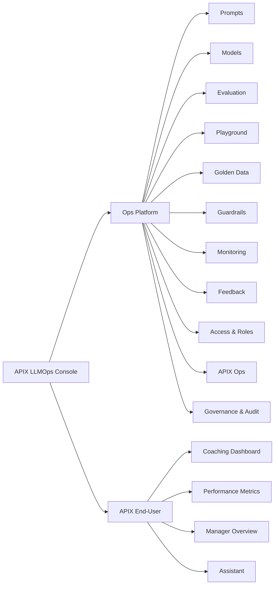
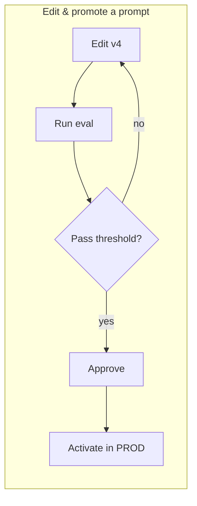
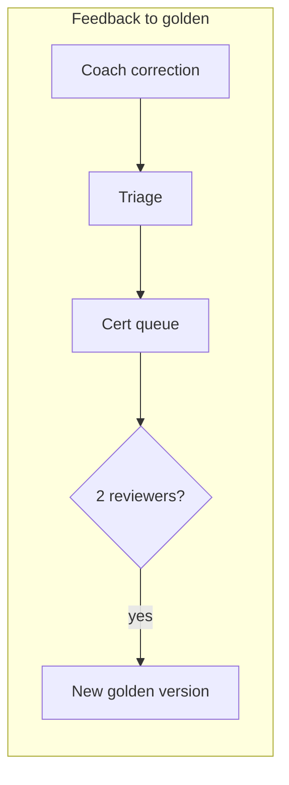

# UX / Wireframe Design Specification
## APIX LLMOps Platform

> Visual-first. ASCII wireframes for layout intent; Mermaid for flows. Polished mockups of 3 key screens exist in the deck (AFNI LLMOps - Approach for APIX.pptx). Traces to SRS (02) FRs.

---

## 1. Introduction
**Purpose:** define the UX for the Ops Platform (the product's face) and the APIX end-user surfaces.
**Principles:** one console for everything · show live APIX data in every module · governed actions are explicit (eval + approval) · never show raw PII · role-scoped by default · fast scan (status colour, badges).

---

## 2. Information Architecture



### 2.1 Global shell (all Ops screens)
```
+-----------------------------------------------------------------------+
| APIX LLMOps        [ search ]                      [ user v ] [ bell ] |
+-----------+-----------------------------------------------------------+
| Prompts   |                                                           |
| Models    |                                                           |
| Eval      |     < module content area >                               |
| Playground|                                                           |
| Golden    |                                                           |
| Guardrails|                                                           |
| Monitoring|                                                           |
| Feedback  |                                                           |
| Access    |                                                           |
| APIX Ops  |                                                           |
| Governance|                                                           |
+-----------+-----------------------------------------------------------+
```

### 2.2 Role-based visibility
| Module | Admin | Manager | Coach | QA | Agent |
|--------|:--:|:--:|:--:|:--:|:--:|
| Prompts / Models / Playground | Edit | - | - | View | - |
| Evaluation | Run+Promote | - | - | Run | - |
| Golden Data | Manage | - | - | Certify | - |
| Guardrails / Governance | Manage | View | - | View | - |
| Monitoring | Full | Team | Own | View | - |
| Feedback | Manage | Team | Submit | Certify | Appeal |
| APIX Ops | Full | View | - | - | - |
| Coaching Dashboard | All | Team | Own agents | Review | Own |

---

## 3. Design System (brief)
- **Colour:** navy (frame), teal (primary), green=pass/strong, amber=warn/medium, red=fail/focus, slate (text).
- **Components:** sidebar nav, cards (shadow + left accent), status badges, data tables, scorecards, bar/trend charts, diff view, side-by-side panels.
- **Typography:** Segoe UI; bold section heads; monospace for prompt text / IDs.

---

## 4. Ops Platform Screens

### 4.1 Prompt Management (FR-PM)
```
Prompts  >  PSO  >  analysis
+------------------------------+  +-------------------------------+
| Versions                     |  | Editor - v4 (draft)           |
| v4 draft        [in review]  |  | [ prompt text ............. ] |
| v3 active PROD  [live]       |  | ...                           |
| v2 archived                  |  | change note: [_____________]  |
| v1 archived                  |  | [Save draft] [Diff vs v3]     |
+------------------------------+  +-------------------------------+
        [ Activate ]  (disabled until eval pass + approval)
```
Key: version list with env/status badges; editor; diff; activate gated by governance.

### 4.2 Model Management (FR-MM)
```
Aliases (env: PROD)                 Task: call_analysis
+-------------------------+         +---------------------------+
| reasoning -> gpt-5-nano |         | prompt: analysis v3       |
| bulk      -> gpt-5-nano |         | model:  reasoning         |
+-------------------------+         | params: temp 1.0          |
Pinned versions: [ view ]           | [ Re-bind ] (governed)    |
                                    +---------------------------+
```

### 4.3 Evaluation (FR-EV)
```
Evaluation - analysis v4 (PSO)  vs  golden v7
Overall pass rate: 0.96      Threshold PROD 0.95   ->  PROMOTABLE
+-------------------------------+   Fairness
| escalations        PASS       |   native 0.86 / non-native 0.71  (!) flag
| save_attempts      PASS       |
| bs_empathy  +/-0.1 PASS       |   [ Promote to PROD ]  (audited)
| overall_behavior   FAIL       |
+-------------------------------+
```

### 4.4 Playground (FR-PG)
```
Playground     Transcript: [ sample-123 v ]
+-- Combo A ---------------+   +-- Combo B ---------------+
| prompt v3 | gpt-5-nano   |   | prompt v4 | gpt-5-mini   |
| temp 1.0  | [ Run ]      |   | temp 1.0  | [ Run ]      |
| output ................ |   | output ................ |
| 5.2k tok  $0.001  1.6s   |   | 5.3k tok  $0.004  2.1s   |
+-------------------------+   +-------------------------+
            [ Send winner to Evaluation ]        (no prod impact)
```

### 4.5 Golden Dataset (FR-GD)
```
Golden > PSO (v7)                 Certification queue
+---------------------------+     +--------------------------+
| call 9062-...  certified  |     | cand #12  reviewer1 OK   |
| call 9063-...  certified  |     | cand #12  reviewer2 ... |
+---------------------------+     | (needs 2-reviewer concur)|
[ Add entry ]                     +--------------------------+
```

### 4.6 Guardrails (FR-GR)
```
Policy                          Activity (today)
+------------------------+      PII flags: 212  [ view audit ]
| PII        : redact    |      Secrets  : 0
| Secrets    : block     |      Injection: 3
| Injection  : block     |
| Content    : flag      |      (change action = config, no rebuild)
+------------------------+
```

### 4.7 Monitoring (FR-MO)
```
Cost by program (today)        Ops
Telesales ####   $32           latency p95: 1.8s
WCC       ##     $18           error rate : 0.4%
PSO       #####  $41           flag rate  : 0.2%
[ drill to trace -> metadata/IDs only ]     Alerts: 1 (cost)
```

### 4.8 Feedback (FR-FB)
```
Feedback inbox
+-----------------------------------------------+
| call 9062 / seg 14 | empathy 0->1 | analysis v3 | in-review |
| ...                                                         |
+-----------------------------------------------+
[ Triage ] -> route to Golden certification
```

### 4.9 Access & Roles (FR-AR) — user list + role assign; Entra SSO; scope note.
### 4.10 APIX Operations (FR-OP)
```
Run pipeline   Program: [PSO v]  Date: [2026-08-16]  [ Run ]
denoise  [OK]  analysis [running] summary [ ] metrics [ ] kpi [ ]
[ View report ]   Program config: targets / thresholds / bands [ edit ]
```
### 4.11 Governance & Audit (FR-GA) — approval queue + audit explorer (reconstruct any score).

---

## 5. APIX End-User Screens
- **5.1 Coaching Dashboard** — agent header + score gauge, behaviour bars, KPI cards, AI coaching tip with evidence (polished mockup in deck).
- **5.2 Performance Metrics** — per-agent KPI cards, week-over-week deltas, trends.
- **5.3 Manager Overview** — team rankings, top performers, needs-focus, escalation alerts.
- **5.4 Assistant** — chat panel scoped to the user's agents; history; feedback capture.

---

## 6. Key User Flows




---

## 7. Interaction & States
Every screen defines: empty, loading, error, success, permission-denied. Gated actions (activate/promote) show disabled state with reason until eval+approval satisfied.

## 8. Accessibility
Target WCAG 2.2 AA: keyboard nav, contrast, labels, focus order; status never by colour alone (badge text too).

## 9. Open Items
- High-fidelity visual comps (Figma) beyond these wireframes.
- Chatbot conversation UX detail.
- Mobile/responsive behaviour for dashboards.
- Final design-system tokens (ties to any AFNI brand guidance).
