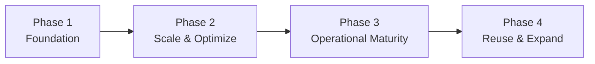
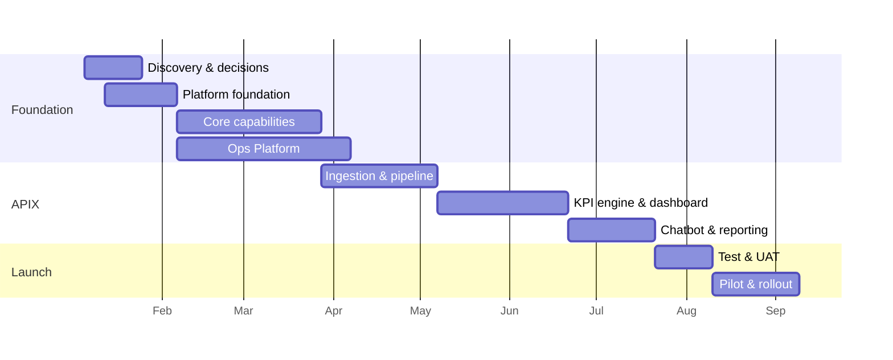

# Project Implementation Plan
## APIX LLMOps Platform

> The delivery plan: approach, WBS, estimates, timeline, team, and the RAID (risks, assumptions, issues, decisions) deliberately kept out of the BRD. Traces to BRD (01), SRS (02), Architecture (03), UX (04).

---

## 1. Introduction
**Purpose:** plan the end-to-end build of APIX on a reusable LLMOps platform, operated through the Ops Platform.
**Objective:** APIX live in production, governed by LLMOps, with the core reusable by configuration.

---

## 2. Delivery Approach
Phase-based, dependency-sequenced (not feature-cut). Each capability lands on a working foundation.

- **Phase 1 Foundation:** platform core (8 capabilities) + Ops Platform + APIX end-to-end + launch.
- **Phase 2:** throughput/rate-limit, FinOps controls, caching.
- **Phase 3:** release promotion, kill-switch/incident, deprecation lifecycle.
- **Phase 4:** onboard a second use case by configuration.

---

## 3. Scope Summary
In: LLMOps core, Ops Platform (11 modules), APIX app (ingestion→reporting), user onboarding. Out: second use case build; real-time/streaming ingestion. (Per BRD §3.)

---

## 4. RAID Log

### 4.1 Decisions / Open Items (must close)
| ID | Decision | Impacts |
|----|----------|---------|
| D-1 | Compliance/regulatory standards (PCI/HIPAA-eq/SOC2/state insurance) | Guardrails, retention, security, Content Safety cost |
| D-2 | Expected scale (calls/day, users, concurrency) | Infra sizing, cost, throughput design |
| D-3 | Final program/LOB list + KPI rulebooks | KPI engine, golden data scope |
| D-4 | Governance ownership + advisory-vs-approval gate | Feedback flow, governance module |
| D-5 | Registry store: Cosmos vs Azure SQL (ADR-1) | Data architecture, persistence |
| D-6 | Delivery team model (full vs core) | Timeline, capacity |
| O-1 | Data dictionary detail per entity | SRS completeness |
| O-2 | Retention values | Security/data design |
| O-3 | BR→FR→test traceability matrix | Test design |
| O-4 | Network topology / landing zone | Deployment design |

### 4.2 Risks
| ID | Risk | Mitigation |
|----|------|------------|
| R-1 | Content Safety on 100% of calls could cost $2.3–6k/mo | Layered guardrails; Content Safety selective (arch §11.2) |
| R-2 | KPI composite score unfair across care vs sales | Redefine per-program; validate vs SME samples |
| R-3 | Golden-data certification bottleneck (SME time) | Prioritize high-value probes; 2-reviewer queue; grow over time |
| R-4 | Azure OpenAI rate limits at full volume | Batching, retry/backoff, provisioned throughput (Phase 2) |
| R-5 | Decisions delayed → dependent work slips | Track D-1..D-6 from week 1; parallelize non-blocked work |

### 4.3 Assumptions
POC prompts reusable as v1; Azure access provisioned; SMEs available for certification; existing POC architecturally sound (rebuild, not re-invent).

### 4.4 Issues
_None open at baseline._

---

## 5. Dependencies
Client decisions (D-1..D-4); SME availability (KPI, golden data); Azure subscription (ready); source transcript access.

---

## 6. Work Breakdown Structure (Epics → Stories)

| Epic | Key stories | Est. (days) |
|------|-------------|------------:|
| E1 Discovery & decisions | Confirm D-1..D-6; translate compliance/scale/programs | 15 |
| E2 Platform foundation | Repo, environments, CI/CD, config-as-code, Key Vault/identity | 20 |
| E3 Prompt management | Registry, versioning, activate/rollback, diff, stamping | 18 |
| E4 Model management | Alias→deployment, task binding, pinning, resolution | 15 |
| E5 Evaluation gate | Golden framework, probe eval, thresholds, fairness, CI wiring | 25 |
| E6 Guardrails | PII/secrets/injection, content safety (layered), policy config, audit | 20 |
| E7 Observability | Trace schema, Azure Monitor, dashboards, alerts | 15 |
| E8 Feedback loop | Capture, certification queue, routing to golden | 15 |
| E9 Governance & audit | Approval workflow, audit explorer, RBAC enforcement | 15 |
| E10 Ops Platform (shell + 11 modules) | Frontend shell, nav, all module UIs wired to core | 45 |
| E11 Data ingestion | Scheduled ingest, validation, backfill | 15 |
| E12 AI pipeline rebuild | denoise/analysis/summary on seam; parity validation | 25 |
| E13 KPI/scoring engine | Codify rulebooks, composite score, fairness, validation | 25 |
| E14 Coaching dashboard | Scorecards, behaviour, comparisons, coaching tips | 25 |
| E15 Chatbot | NL→SQL, scope injection, UI, history/feedback | 20 |
| E16 Reporting & notifications | Scheduled reports, export, email/Teams | 12 |
| E17 User mgmt & admin | Entra SSO, RBAC, provisioning, admin config panel | 15 |
| E18 Testing & UAT | Test suites, eval-gate in CI, UAT | 20 |
| E19 Rollout & enablement | Pilot, remediate, full rollout, training, hypercare | 25 |
| E20 Reusability packaging | Document generic vs APIX-specific; onboarding playbook | 8 |
| **Total (Phase 1 indicative)** | | **~430 days** |

> Estimates are planning-level, pre-team-confirmation. Detailed task breakdown and per-task estimates follow once D-6 (team) and D-2/D-3 (scope inputs) confirm.

---

## 7. Estimates (rollup)
~430 person-days for Phase 1. With the **full team** (~8–10 FTE) ≈ 5–7 months elapsed; with the **focused core** (~4 FTE) ≈ 9–11 months. Confirmed by D-6.

---

## 8. Timeline & Milestones (indicative, full-team)

Milestones: M1 decisions closed · M2 core + Ops shell · M3 APIX pipeline parity · M4 dashboard+chatbot · M5 UAT pass · M6 pilot · M7 full rollout.

---

## 9. Team Structure & RACI

| Role | FTE (full) | FTE (core) | Primary area |
|------|:--:|:--:|------|
| Eng Lead / Architect | 1 | 1 | Architecture, governance, client |
| Cloud/DevOps | 1 | 0.5 | Env, CI/CD, infra, observability |
| Platform Eng | 1.5 | 1 | Config core, Ops backend, auth |
| AI/LLM Eng | 2 | 1 | Prompt/model/eval/guardrails, pipeline, chatbot |
| Data Eng | 1 | 1 | Ingestion, KPI engine, reporting |
| Frontend Eng | 1.5 | 1 | Ops Platform UI, dashboard |
| QA/Eval Eng | 1 | 0.5 | Golden data, eval, testing |
| Security/Compliance | 0.75 | shared | PII, audit, compliance mapping |
| BA/SME Liaison | 0.75 | shared | Decisions, KPI validation |
| UX Designer | 0.5 | shared | Ops + dashboard design |

RACI (summary): Architect = A on design/governance; AI Eng = R on LLMOps core; Data Eng = R on KPI; BA = R on decisions; SMEs = C on KPI/golden/compliance; Sponsor = I/A on sign-offs.

---

## 10. Technology Stack
Per Architecture §10 (React/TS, Python/FastAPI, Azure OpenAI, AI Foundry, Azure SQL, Blob, Entra, Key Vault, Monitor, Content Safety, Container Apps).

## 11. Environments & Tooling
Dev/Test/Prod; GitHub Actions or Azure DevOps; Container Apps; eval gate as required CI step.

## 12. Testing Strategy
Unit + integration per module; pipeline parity vs POC; **evaluation gate** on every LLM change; security/guardrail tests; UAT with coaches/QA; fairness validation.

## 13. Deployment & Rollout
Pilot one confirmed program → remediate → full rollout across programs → training (coaches/managers/QA/agents) → hypercare.

## 14. Governance & Reporting
Weekly delivery status; decision-register review; change control via eval+approval; phase-gate reviews at each milestone.

---

## 15. Open Items
Consolidated in RAID §4.1 (D-1..D-6, O-1..O-4). Estimates and timeline firm up once D-2/D-3/D-6 confirm.
